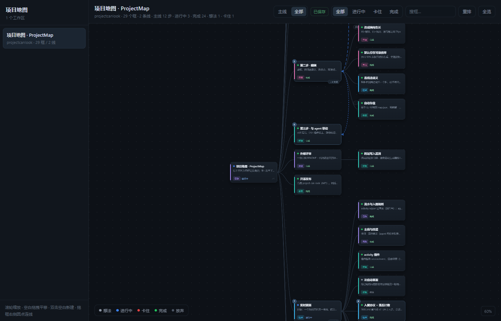
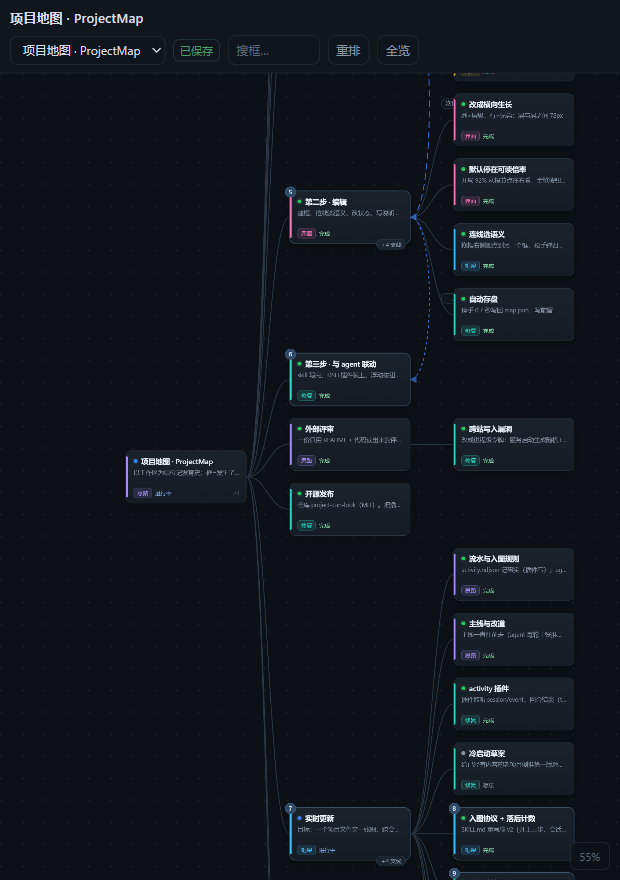

# 项目地图 · ProjectMap

把每个项目的发育史画成一棵能拖、能改的树。**框是已经发生的事，线是接下来要什么。**



一个零依赖的本地小工具：一个 Node 脚本 + 一个手写的 SVG 画布，不装 npm 包、不用数据库，
数据就是你项目文件夹里的一个 JSON。

> **EN** — A zero-dependency local tool that turns each project folder into an editable,
> draggable tree of decisions. Nodes record what happened; typed edges record what you want
> next (merge / reference / dependency / order). A JSON file per project is the only state.
> Built for one person's workflow with coding agents, not a general-purpose diagram editor.

## 它解决什么

同时推进十几个项目时，真正难的是"这个项目长到哪了、下一步从哪儿接"，而不是记不住细节。
所以这里有三个设计选择，跟普通流程图工具不一样：

**1. 树记录发育，不记录流程。**
一个框只能有一个爹，分叉就是兄弟。跨分支的关系不塞进树里，走单独的"线"。

**2. 线必须带语义。**
随便一根 A—B 的线，机器读不懂。所以拖线时必须选一种：合成 / 参考 / 依赖 / 次序。
其中"合成"会记下一张配方 —— 从 A 取什么、从 B 取什么、要做出什么。

```json
{ "type": "merge", "from": "n4", "to": "n5", "status": "pending", "policy": "plan",
  "recipe": { "take": { "n4": ["数据结构", "交互逻辑"], "n5": ["视觉风格"] },
              "product": "合体版页面", "words": "数据层那套逻辑 + 界面层的皮" } }
```

这张配方是给 coding agent 看的：它知道要去哪两个节点各取什么，而不是靠猜"这两块有什么关系"。

**3. 只有状态色，没有进度条。**
`想法 / 进行中 / 卡住 / 完成 / 放弃`。百分比是假的，颜色骗不了人。

## 快速开始

需要 Node 18+，没有任何依赖。

```bash
node server.mjs          # → http://127.0.0.1:8377
```

默认扫描**本程序所在目录的上一层**里的所有 `<子目录>/.projectmap/map.json`。
所以最常见的用法：把本仓库放进你的项目总目录，它就能看到所有项目。

```bash
# 或者明确指定要扫哪个目录
PROJECTMAP_ROOT=D:\work node server.mjs

# Windows
start.bat                # 无窗口后台启动，日志写 server.log
stop.bat                 # 停掉占 8377 的进程
```

### 造第一张图

在任意项目目录下建 `.projectmap/map.json`，最小可以只有根节点：

```json
{
  "schema": 1,
  "workspace": "my-project",
  "title": "我的项目",
  "nodes": [{ "id": "n1", "parent": null, "title": "开工", "kind": "idea", "status": "doing", "note": "" }],
  "edges": []
}
```

### 自动记流水（装成插件后）

插件会监听会话事件，**每个回合结束写一行**到 `<项目>/.projectmap/activity.ndjson`：

```json
{"v":1,"at":"…","sid":"abc","turn":7,"ask":"把拖拽的判定改一下",
 "files":["D:/x/web/app.js","D:/x/web/app.css"],"cmds":["git commit -m \"fix\""]}
```

它只记事实，不写 `map.json`。两条刹车：

- 没有 `.projectmap/map.json` 的项目**完全不碰**（轻量项目零开销）
- `map.json` 里 `"settings": { "enabled": false }` 也完全不碰

文件超过 1MB 会轮转成 `activity.1.ndjson`。


刷新页面，左边就会出现这个项目。完整的结构可以照抄 [`examples/map.example.json`](examples/map.example.json)。

## 怎么用

树从左往右长：列 = 层级，行 = 同层的兄弟。开局停在能读字的倍率，想缩就滚轮缩。

| 想干的事 | 怎么操作 |
|---|---|
| 新建框 | 空白处双击（先选中一个框就建在它下面） |
| 连线 | 鼠标悬停在框上，右边缘冒出一个圆点，拖到另一个框松手 |
| 选线的语义 | 松手后弹菜单：合成 / 参考 / 依赖 / 次序 |
| 合成 | 弹表单填：从 A 取什么、从 B 取什么、要做出什么、这条线怎么处理 |
| 改框 | 点框，右侧面板改标题、状态、类型、父节点、说明、关联文件/链接 |
| 换位置 | 直接拖；位置会记住，`重排` 清掉手拖痕迹 |
| 删 | 面板底部删除（子节点自动挂到上一层），线在列表里点 × |

改完自动存：停手 0.7 秒写回 `map.json`，写前留一份 `map.json.bak`。

## 数据格式

每个项目一个文件：`<项目目录>/.projectmap/map.json`。跟着项目走，能进 git，坏了能手改。

**节点**

| 字段 | 说明 |
|---|---|
| `id` | 唯一，别改 |
| `parent` | 上一个框的 id；`null` 表示顶层 |
| `title` | 一句话 |
| `kind` | `idea` 思路 / `frame` 框架 / `content` 内容 / `ui` 界面 / `fix` 修复 / `other` |
| `status` | `idea` / `doing` / `blocked` / `done` / `dropped` |
| `note` | 做完什么、卡在哪 |
| `refs` | `[{type, value, label}]`，`type` 是 `file` / `url` / `session` |

**线**

| 字段 | 说明 |
|---|---|
| `from` / `to` | 两个节点 id |
| `type` | `merge` 合成 / `ref` 参考 / `dep` 依赖 / `flow` 次序 |
| `status` | `pending`（还没落实）/ `done` |
| `policy` | `ask` 先记着 / `plan` 先出方案 / `auto` 直接做（可省略，跟 `settings.mergePolicy`） |
| `recipe` | 合成专用：`{ take: {节点id: [取什么]}, product, words }` |

## 给 agent 用

仓库里的 [`skills/projectmap/SKILL.md`](skills/projectmap/SKILL.md) 是一份给 coding agent 的规则：
开工前读图、收尾补节点、处理 `pending` 的线。在 Claude Code / DeepSeek Harness 这类
支持 skill 的环境里，把它放进 skills 目录即可（路径按你的环境改）。

## 塞进 DeepSeek Harness（可选）

两种用法，二选一。

### A. 一行装成 DSH 插件（同源，推荐）

这个仓库本身就是一个 DSH 插件包（host 侧，不用客户端 bundle）。装它：

```bash
dsh plugin --profile web add github:goodtime7777/project-can-look
# 然后重启 dsh
```

装完 DSH 自己的 web 服务上就多了 `/projectmap/`：没有独立端口、没有额外进程、没有 CORS。
页面右侧还会出现一颗浮动按钮，点一下在侧边栏打开地图。

- 地址：`http://localhost:<你的端口>/projectmap/`
- 扫描根目录：默认用 `dsh web` 的工作目录；想固定就在自己 profile 的 `cordis.patch.yml` 里覆盖：

  ```yaml
  - id: dsh-projectmap
    config:
      root: /path/to/your/projects
  ```

- 卸掉：`dsh plugin --profile web remove dsh-projectmap`，然后重启

> **为什么是 localhost 不是 127.0.0.1**：DSH 右侧边栏的浏览器标签有一个保护 ——
> 目标 origin 与应用自身相同时拒绝嵌入（`error.application-origin`）。用 `localhost`
> 换个 origin 字符串就绕过了，服务还是同一个。<br>
> 那颗浮动按钮会自动判断该用哪个主机名，不用你管。

### B. 独立服务 + 侧边栏浏览器

不装插件也行。DSH 的右侧边栏带一个能加载 `127.0.0.1` 页面的浏览器标签，Web 版默认关着。
在 `~/.dsh/profiles/web/cordis.patch.yml` 末尾加：

```yaml
- id: ui-sidebar-browser
  disabled: false
```

重启 `dsh web`，然后在聊天里点 `http://127.0.0.1:8377` 这个链接 —— 默认设置下它会在
右侧边栏打开，并且这个标签会按会话记住，刷新自动恢复。

窄到 700px 以下时页面会自动切窄屏：左侧工作区列表收成顶栏下拉、详情面板变成底部抽屉。



## 目录

这个仓库同时是「能单独跑的小工具」和「一个 DSH 插件包」—— 两者共用同一份前端。

```
package.json          DSH 插件包声明（dsh.bundle.patch / dsh.client）
cordis.patch.yml      插件挂载补丁
lib/index.js          host 侧：注册 /projectmap 路由 + 注入浮动按钮
lib/client.js         客户端侧：把 sidebarRight.openTab 包成一个函数
web/                  前端：index.html / app.js / app.css，无构建、无第三方库
server.mjs            独立服务（静态页 + 读写 map.json），不依赖 DSH
examples/             示例 map.json
skills/projectmap/    给 agent 的读写规则
docs/                 截图
test-routes.mjs       插件路由的自测（node test-routes.mjs）
start.bat / stop.bat  Windows 启停
serve.vbs             Windows 无窗口启动器
```

## 已知限制

- 画布是固定布局 + 拖拽，不是自动布局引擎；节点多了要靠缩放和搜索
- 只做了单用户单机，没有协作、没有历史版本、没有 undo
- Windows 的启停脚本是 `.bat`/`.vbs`；其他平台直接 `node server.mjs`
- 边只有四种语义，够用但不再扩展（加语义会让"线是什么"变模糊）

## License

MIT
